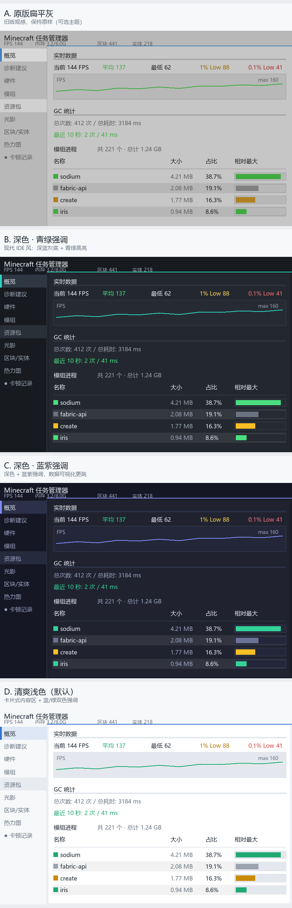

# Minecraft Task Manager

> 游戏内性能诊断工具 · 官方模组

一个纯客户端 Fabric 模组，帮助玩家在游戏内查看模组、资源包、光影、硬件信息，自动检测卡顿并给出可执行的优化建议。

## 功能

- **实时监控**：FPS、帧时间、内存、区块、实体
- **性能趋势**：FPS / 帧时间 / 内存三条独立曲线
- **GC 统计**：堆内存、GC 次数、GC 耗时
- **模组列表**：按大小排序，优化/重负载模组分类标记
- **资源包 & 光影**：当前启用项、文件大小、优化组合识别
- **硬件信息**：CPU / GPU / 内存（跨平台，支持手动修正）
- **方块实体排行**：漏斗、箱子、熔炉等，附坐标定位
- **热力图**：附近区块方块实体/实体密度可视化
- **卡顿追踪**：自动记录卡顿现场 + 诊断原因（GC/实体/区块）
- **会话记录**：退出世界后自动保存本次游戏数据
- **一键调设置**：诊断建议旁边直接改游戏设置
- **导出报告**：所有数据导出为 JSON
- **可切换界面主题**：内置 4 套配色（清爽浅色 / 深色青绿 / 深色蓝紫 / 原版扁平灰），在设置页即时切换



## 安装

1. 安装 [Fabric Loader](https://fabricmc.net/use/installer/) 0.16.0+
2. 安装 [Fabric API](https://modrinth.com/mod/fabric-api)
3. 下载本模组的 jar 放进 `.minecraft/mods/`
4. 启动游戏，按 **K** 打开任务管理器

## 支持版本

- Minecraft: **1.21.1**
- Fabric Loader: **>=0.16.0**
- Java: **>=21**

## 从源码构建

构建本模组时，**Gradle 自身必须运行在 JDK 25 或更高版本上**（Loom 1.18.x 的要求）；
模组产出的字节码仍然是 Java 21（`build.gradle` 里 `options.release = 21`），
所以上面「支持版本」中的 Java >=21 依然成立。

```bash
# 确保 JAVA_HOME 指向 JDK 25+
./gradlew build        # 产物：build/libs/tkmanager-<version>.jar
./gradlew runClient    # 直接启动带本模组的客户端
```

Gradle 9.7.1 由 wrapper 自动下载（使用腾讯云镜像）。版本号统一由 `gradle.properties`
的 `version` 决定，会注入 `fabric.mod.json` 的 `${version}` 占位符。
